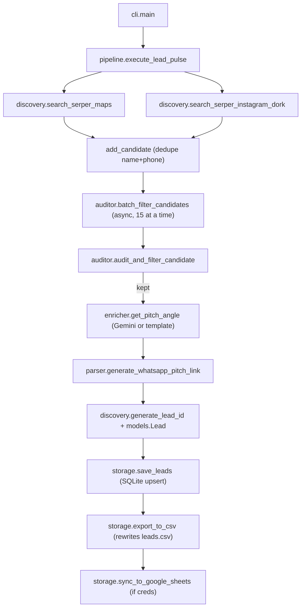

# LeadPulse NG – Scraper Technical Report

> Read-only analysis. No code was changed.

---

## 0. Urgent findings (read first)

| # | Issue | Where |
|---|---|---|
| 1 | **`.env.example` holds what look like real API keys** (Serper, Google, Gemini). The example file is the one people usually commit or share. Rotate all three keys and put placeholders in the example file. | `.env.example` lines 3, 6, 9 |
| 2 | **There are two separate scrapers.** `leads.py` is an older standalone script (Google Places API (New) + PageSpeed, writes `leads.db`). The real app is the `leadpulse/` package run through `run.py` (Serper.dev, writes `leadpulse.db` + `leads.csv`). The current `leads.csv` comes from **`leadpulse`**, because its headers match that package. | `leads.py` vs `leadpulse/` |
| 3 | **The README overstates the features.** The package does not use Google Places, PageSpeed, viewport or load-time checks, and it has no "live fallback targets". `GOOGLE_API_KEY` is loaded but never used by the package. | `README.md`, `pipeline.py` |
| 4 | **`run.py test` runs a full sweep** (about 11 Maps queries plus up to 4 search pages, so roughly 15 Serper credits), not a small test. The reason: `niche` is `None`, so the pipeline goes down the `full_sweep or not niche` branch. | `cli.py` L76–79, `pipeline.py` L54 |

---

## 1. Overview

| Item | Detail |
|---|---|
| Purpose | Find Nigerian high-ticket local businesses (shortlets, solar, med-spa, dental, fine dining) that have **no website, only a social/WhatsApp link, or a dead domain**, then produce WhatsApp outreach links. |
| Sources (active package) | **Serper.dev** `POST /maps` (falls back to `/places`) for Google Maps listings. **Serper.dev** `POST /search` for Google "dorks" on `site:instagram.com`. **Each business's own website** (an HTTP GET to check it). **Gemini 2.5 Flash** (optional) to write the pitch line. **Google Sheets** (optional) as an export target. |
| Sources (legacy `leads.py`) | Google Places API (New) `places:searchText` and the PageSpeed Insights API. |
| How it runs | Manual CLI only: `python run.py <collect\|test\|export\|mark\|view>`. **No scheduler** (no cron, Task Scheduler or loop). |
| Language | Python 3.11 (`.venv`). |
| Key libraries | `requests` (Serper calls), `httpx` (async site audit, Gemini), `pydantic` (`Lead` model), `rich` (terminal tables), `python-dotenv`, `gspread`, `sqlite3` (standard library). `beautifulsoup4` and `tabulate` are installed but **never used**. |

Package layout:

```
run.py               -> leadpulse.cli.main
leadpulse/cli.py     argparse subcommands
leadpulse/pipeline.py  orchestration (execute_lead_pulse)
leadpulse/discovery.py Serper Maps + Instagram dork
leadpulse/auditor.py   "Golden Filter" (phone + website checks)
leadpulse/parser.py    Nigerian phone regex, wa.me link builder
leadpulse/enricher.py  Gemini / rule-based pitch
leadpulse/storage.py   SQLite, CSV, Google Sheets
leadpulse/models.py    Lead model + enums
leadpulse/scorer.py    calculate_lead_score  (UNUSED)
leadpulse/config.py    env vars, paths, unused niche/location lists
```

---

## 2. Data flow (`run.py collect …`)



1. **CLI parsing.** [`cli.main`](file:///c:/Users/Rokan/Downloads/automated%20leads/leadpulse/cli.py#L71-L89) decides between sweep and targeted mode. With no `--niche`, or with `--sweep`, it runs a full sweep.
2. **Discovery.** [`execute_lead_pulse`](file:///c:/Users/Rokan/Downloads/automated%20leads/leadpulse/pipeline.py#L28-L186) calls:
   - [`search_serper_maps`](file:///c:/Users/Rokan/Downloads/automated%20leads/leadpulse/discovery.py#L49-L109). Each place becomes a dict with `name, niche, location, website, phone, rating, reviews, maps_url (cid), address, source="serper_maps"`.
   - [`search_serper_instagram_dork`](file:///c:/Users/Rokan/Downloads/automated%20leads/leadpulse/discovery.py#L112-L212). Organic results are parsed. The name and handle come from the title via `clean_ig_title`. Phone and bio link come from the snippet. Niche and location are guessed from keywords.
3. **In-run dedupe.** `add_candidate` uses the key `(name.lower(), phone)`.
4. **Golden Filter.** [`audit_and_filter_candidate`](file:///c:/Users/Rokan/Downloads/automated%20leads/leadpulse/auditor.py#L65-L154):
   - Drop the candidate if it has no valid Nigerian mobile number.
   - No website → `NO_WEBSITE` (100). Maps listings also need **3 or more reviews**.
   - Website on a social, WhatsApp or link-in-bio domain → `SOCIAL_OR_WHATSAPP_ONLY` (95).
   - Otherwise it GETs the site: a redirect to social → 95; HTTP ≥400, a parked-page keyword, or a connection/SSL/other error → `TRULY_DEAD_DOMAIN` (90).
   - A live site → **discarded**.
5. **Pitch.** [`get_pitch_angle`](file:///c:/Users/Rokan/Downloads/automated%20leads/leadpulse/enricher.py#L99-L129) uses Gemini if a key is set, otherwise a template. The calls run **one after another**.
6. **WhatsApp link.** [`generate_whatsapp_pitch_link`](file:///c:/Users/Rokan/Downloads/automated%20leads/leadpulse/parser.py#L49-L73) builds `wa.me/<digits>?text=…`. The `pitch_angle` argument is **ignored**, so every lead gets the same generic message.
7. **ID.** [`generate_lead_id`](file:///c:/Users/Rokan/Downloads/automated%20leads/leadpulse/discovery.py#L30-L33) is the first 12 hex characters of `md5(name_niche_location)`.
8. **Persist.** [`save_leads`](file:///c:/Users/Rokan/Downloads/automated%20leads/leadpulse/storage.py#L42-L107) upserts on `lead_id` and keeps any existing `outreach_status`.
9. **Export.** [`export_to_csv`](file:///c:/Users/Rokan/Downloads/automated%20leads/leadpulse/storage.py#L157-L184) rewrites the whole `leads.csv` from the DB. [`sync_to_google_sheets`](file:///c:/Users/Rokan/Downloads/automated%20leads/leadpulse/storage.py#L187-L225) clears and rewrites sheet 1.

---

## 3. Output

### Locations and formats
| Output | Path | Notes |
|---|---|---|
| SQLite | `leadpulse.db`, table `leads` | Source of truth, 20 columns |
| CSV | `leads.csv` (UTF-8, CRLF) | Rewritten in full on every collect/export; 13 columns |
| Google Sheet | `GOOGLE_SHEET_NAME`, first worksheet | Optional; same 13 columns |

### CSV columns (from `Lead.to_csv_row`)
`Lead_ID, Business_Name, Niche, IG_Handle_URL, Current_Bio_Link, Funnel_Diagnosis, WhatsApp_Number, Lead_Score, AI_Pitch_Angle, Outreach_Status, WhatsApp_Direct_Link, Score_Points, Flaw_Detail`

### Extra DB-only columns (collected but **not exported to CSV**)
`location, source, rating, reviews_count, maps_url, created_at, updated_at`

The **Address** comes back from Serper but is **thrown away**. It is not stored anywhere.

### Real sample record (row 2 of the current `leads.csv`)
This is a public Google Maps business listing, so the phone number is the business's listed number. It is not redacted. Check whether it is actually a personal mobile number before you message it.

```csv
36883ceba35a,Ox restaurant & lounge,Fine Dining,,None,NO_WEBSITE,+2349044444454,High,"Ox has 1634 reviews and a 4.4-star rating, yet customers clicking your profile can't book directly – let's fix that.",Pending,https://wa.me/2349044444454?text=Hi%20Ox%20restaurant%20%26%20lounge%2C%20I%20was%20looking%20through%20your%20online%20presence%20and%20noticed%20a%20quick%20opportunity%20to%20boost%20your%20bookings/inquiries.%20I%20put%20together%20a%20quick%20solution%20preview%20for%20you%E2%80%94can%20I%20send%20it%20over%3F,100,Active Google Maps listing (1634 reviews) with no booking website
```

Observations on the current file (38 leads):
- **All rows are `NO_WEBSITE` from Google Maps.** None are `SOCIAL_OR_WHATSAPP_ONLY` or `TRULY_DEAD_DOMAIN`, and **none came from Instagram** (`IG_Handle_URL` is empty in every row).
- `Current_Bio_Link` holds the literal string `"None"`, not an empty value.
- `Lead_Score` is always `High`.

---

## 4. Data quality

### Phone numbers ([`parser.extract_nigerian_phone`](file:///c:/Users/Rokan/Downloads/automated%20leads/leadpulse/parser.py#L18-L46))
- It checks `wa.me/...` and `api.whatsapp.com/send?phone=` links first, then this general regex:
  `(\+?234[\s-]?|0)([789][01]\d[\s-]?\d{3}[\s-]?\d{4})`
- Only **Nigerian mobile prefixes** are accepted (070x/071x/080x/081x/090x/091x). Landlines (01-…) are rejected, which suits WhatsApp. **Foreign numbers are dropped.**
- Output is **E.164** (`+234XXXXXXXXXX`, 13 digits), and the wa.me link uses the same digits without `+`.
- **It does not check whether the number is on WhatsApp.** "WhatsApp-valid" here only means the number looks like a Nigerian mobile.
- Weak spots:
  - There are no word boundaries, so it can match inside longer digit strings, such as account numbers or two numbers run together.
  - Formats like `(0803) 123 4567`, dots (`0803.123.4567`) or double spaces don't match, and those leads are silently **discarded**.
  - Only the **first** number is kept.
  - New number ranges (e.g. 0702x, 0913x) do match. Ranges outside `[789][01]` would not.

### Duplicates
- **Within one run:** `(lowercased name, phone)`. The same business with a slightly different name, or a different phone format before normalisation, gets through.
- **Across runs:** the DB primary key is `md5(name, niche, location)`. Because niche and location are the **search labels**, not facts about the business, the same business found by two queries ends up as **two leads with the same phone number**. Example: "Shortlet Ikoyi" vs "Serviced apartments Victoria Island". **Phone number is not used as a unique key.**
- Maps and Instagram leads for the same business are never merged.

### "No website" decision
- `bio_link`/`website` is empty or `"none"`/`"null"` → `NO_WEBSITE`. Maps leads also need `ratingCount >= 3`, otherwise they are dropped.
- For Instagram leads, "no website" means **no URL appeared in the Google snippet**. That is unreliable, because snippets are truncated and often leave out the bio link. The result is false `NO_WEBSITE` positives.
- A social or link-in-bio domain (21 hosts, see `SOCIAL_OR_WHATSAPP_DOMAINS`) counts as "no real website".
- "Dead domain" false positives:
  - **403s from Cloudflare or other bot protection** are counted as dead.
  - The 8 s timeout means slow Nigerian hosts are counted as "DNS failure".
  - The keyword `"under construction"` anywhere in the first 2,500 characters triggers it.
- `verify=False` is set on the client, so the **"Expired SSL" branch effectively never fires**. Sites with expired certificates load and get discarded as "working".

---

## 5. Filtering and configuration

All of these are **hard-coded in Python**. There is no config file or CLI for lists.

| What | Where | Values |
|---|---|---|
| Sweep queries (niche × area) | `discovery.PRESET_MAPS_TARGETS` | 11 tuples: Shortlet (Lekki, VI, Ikoyi, Wuse), Solar (Lagos, Lekki, Abuja), Med-spa (VI, Lekki), Dental (Lekki Ph1), Fine dining (VI) |
| Default IG dork | `search_serper_instagram_dork` | `site:instagram.com (shortlet OR solar OR medspa OR dental) (Lekki OR "Victoria Island" OR Ikoyi OR Abuja) (080 OR 081 OR 090 OR 070 OR 091 OR 234 OR wa.me)` |
| Targeted mode | CLI `--niche`, `--location`, `--limit` | Builds `"{niche} in {loc}"` for Maps and a custom IG dork. Location defaults to `Lagos, Nigeria` |
| Serper geo | `search_serper_maps` body | `"location": "Nigeria"` |
| IG niche/area tagging | keyword `if/elif` chains in discovery | shortlet/apartment/airbnb, solar/inverter, medspa/aesthetic/facial, dental/dentist/teeth; lekki, victoria island, ikoyi, abuja/wuse/maitama |
| Min reviews | `auditor` | `>= 3` for Maps no-website leads |
| Export filter | `run.py export --min-score N` | Scores are only ever 90, 95 or 100 |
| **Unused** | `config.DEFAULT_NICHES`, `config.DEFAULT_LOCATIONS`, `scorer.calculate_lead_score` | Defined but never referenced |

Limits:
- Maps returns one page per query, with no pagination, so each query gives at most about 20 results.
- IG fetches up to 4 pages.
- In sweep mode the limits are fixed at 15 (Maps) and 30 (IG).

---

## 6. Reliability

| Area | Current state |
|---|---|
| Error handling | Serper errors are caught and printed as `[Warning]`, and the query returns `[]`, so runs continue but **failures are quiet**. A non-200 from Serper (e.g. quota exhausted, 401) is not reported; `/maps` silently falls back to `/places`, then returns nothing. Gemini errors fall back to the template without telling you. Sheets errors are returned as a message. |
| Retries | **None** anywhere. |
| Rate limiting | Serper calls run one at a time with no delay. Site audits run 15 at a time. Gemini calls run one at a time with no throttle, so a 429 means you silently get the template pitch. |
| Proxies | None. |
| Anti-bot | A fixed Chrome 128 User-Agent only. Google is never scraped directly; Serper takes care of that, which is the most robust part of the design. |
| Logging | Console output only (`rich`). No log file and no run history. |

**Likely to break or mislead:**
1. **Serper credits or quota run out.** You get "No candidates discovered" with no error explaining why.
2. **`worksheet.update("A1", rows)`.** gspread 6.x changed the argument order to `update(values, range_name)`. This call is deprecated and may misbehave.
3. **Gemini model name** `gemini-2.5-flash` and the `thinkingConfig` field are hard-coded. A model retirement silently drops you back to the templates.
4. The **Gemini key is sent in the URL query string**, so it can show up in proxy or HTTP logs.
5. **`mark` uses `LIKE %query%`.** A short query like `"Spa"` updates many leads at once.
6. **Every run fully rewrites `leads.csv`.** If the file is open in Excel, the write fails with `PermissionError` and the run crashes after the DB save.
7. Instagram title formats change often, which breaks the parsing in `clean_ig_title`.
8. False positives in the dead-domain checks, covered in §4.
9. `.env.example` line 15 contains a stray `y`. It's harmless, but it is junk.

---

## 7. Gaps for WhatsApp outreach

| Field | Status | What it would take |
|---|---|---|
| **Phone in international format** | ✅ Already E.164 `+234…` in `WhatsApp_Number`. ⚠️ Not checked against WhatsApp. | **Low effort.** Add word boundaries and allow `()`/`.` in the regex, and store every number found, not just the first. To confirm a number is on WhatsApp you need the WhatsApp Business Cloud API, or a third-party checker (paid, and against WhatsApp's terms if done in bulk). |
| **Area** | ⚠️ Only the *search label* (e.g. "Lekki, Lagos"), and it lives in the DB, not the CSV. The real address is thrown away. | **Low effort.** Keep `p["address"]` and add `address` and `location` columns to the schema, `Lead` and `to_csv_row`. Optionally parse the neighbourhood out of the address. |
| **Business type** | ⚠️ `Niche` = search label. Serper returns `type`/`types` (the Google category), which is ignored. | **Low effort.** Store `p.get("type")` / `p.get("types")` as `google_category`. |
| **Instagram handle** | ❌ Empty for all Maps leads. IG leads store the full URL but not the `@handle`, even though `clean_ig_title` extracts it and then throws it away. | **Medium effort.** (a) Save the handle `clean_ig_title` already returns. (b) For Maps leads, run one Serper search per lead, `site:instagram.com "<business name>" <area>`, and pick the best profile match by fuzzy name match or matching phone. That's about 1 credit per lead. |
| **Rating** | ⚠️ Collected and stored in the DB, not exported to CSV. | **Trivial.** Add it to `to_csv_row` and the headers. |
| **Number of reviews** | ⚠️ Same as rating (`reviews_count`). | **Trivial.** Same change. |
| **Photos** | ❌ Not collected. | **Low to medium effort.** Serper Maps returns `thumbnailUrl`; store it. For a photo count or more images, use Google Places API (New) `places.photos` (needs `GOOGLE_API_KEY`, billed) via `placeId`/`cid`. |
| Maps URL | ⚠️ In the DB, not the CSV. | Trivial: export it. |
| Opening hours / business status | ❌ | Serper returns `openingHours`. Places can filter out `CLOSED_PERMANENTLY` leads, as the legacy `leads.py` already does. |

Smaller follow-ups that would help:
- Use the **phone number as the dedupe key**.
- Actually use the AI pitch in the wa.me message (`generate_whatsapp_pitch_link` currently ignores it).
- Write `""` instead of `"None"` for empty bio links.

---

## 8. Environment

### Env vars (loaded from `.env` by `leadpulse/config.py`)
| Name | Required? | Used by |
|---|---|---|
| `SERPER_API_KEY` | **Required.** Without it, discovery returns nothing. | discovery |
| `GEMINI_API_KEY` | Optional. Without it you get template pitches. | enricher |
| `GOOGLE_SERVICE_ACCOUNT_FILE` | Optional. Path to a service-account JSON for Sheets sync. | storage |
| `GOOGLE_SHEET_NAME` | Optional. Default `LeadPulse NG Leads`. | storage |
| `GOOGLE_API_KEY` | Loaded but **unused** by the package. Required only by the legacy `leads.py` (read from the OS environment, not `.env`). | leads.py |

### Install
```powershell
cd "c:\Users\Rokan\Downloads\automated leads"
python -m venv .venv            # already exists (Python 3.11)
.venv\Scripts\activate
pip install -r requirements.txt
copy .env.example .env          # then put in your own (rotated) keys
```

### Run
```powershell
python run.py collect --niche "Shortlet Apartments" --location "Lekki Phase 1, Lagos" --limit 20
python run.py collect --sweep          # all 11 preset queries + IG dork
python run.py test                     # NOTE: also runs the full sweep (see §0)
python run.py view
python run.py export --min-score 90 --sheets
python run.py mark "Dando Solar" "DM Sent"   # Pending | Preview Built | DM Sent | Closed
```

Legacy script, if you want it (separate DB `leads.db`; it overwrites the same `leads.csv` with a different schema):
```powershell
$env:GOOGLE_API_KEY="..." ; python leads.py collect "dental clinic" "Ikeja" ; python leads.py export
```
